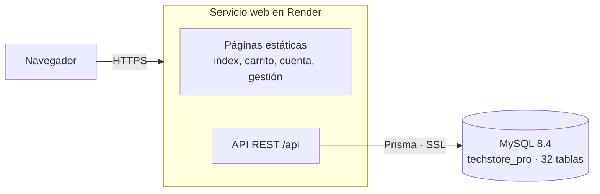
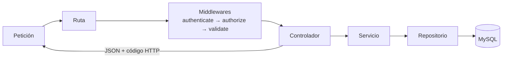
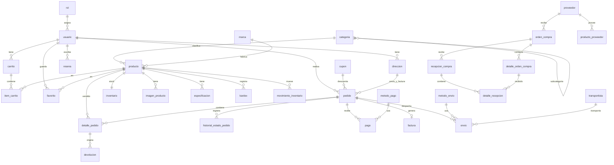

# TechStore Pro — Arquitectura, modelos y APIs

Documento de referencia del proyecto: cómo está construido, dónde está cada parte en el código y qué APIs expone.

| Recurso | Enlace |
|---|---|
| Tienda publicada (frontend + API) | https://techstore-app-jb38.onrender.com |
| Estado de la API | https://techstore-app-jb38.onrender.com/api/health |
| Código fuente | https://github.com/AndresClavs/techstore-v2 |
| Especificación de la base de datos | [TechStore_Pro_Contexto_BD.md](../TechStore_Pro_Contexto_BD.md) |
| Especificación de la arquitectura | [ARQUITECTURA_BACKEND_TechStore_Pro.md](../ARQUITECTURA_BACKEND_TechStore_Pro.md) |
| Especificación de endpoints y despliegue | [IMPLEMENTACION_Y_DESPLIEGUE_TechStore_Pro.md](../IMPLEMENTACION_Y_DESPLIEGUE_TechStore_Pro.md) |

---

## 1. Arquitectura general

Estilo **N capas + REST**. Un solo servicio Node.js (Express) sirve las páginas y la API `/api` en el mismo dominio. Los datos viven en MySQL y se acceden mediante Prisma.



| Capa | Tecnología | Carpeta |
|---|---|---|
| Presentación (frontend) | HTML, CSS y JavaScript (módulos ES) | raíz del repo, `assets/`, `js/` |
| API / rutas | Express 4 | `backend/src/routes/` |
| Middlewares | JWT, Zod, Helmet, CORS, rate limit, XSS | `backend/src/app.js`, `backend/src/middleware/` |
| Controlador | Controlador genérico | `backend/src/controllers/` |
| Negocio | Servicios | `backend/src/services/` |
| Acceso a datos | Prisma 6 (Singleton + Repository) | `backend/src/models/`, `backend/prisma/` |
| Base de datos | MySQL / MariaDB | `database/` |
| Despliegue | Render (Blueprint) + Aiven MySQL | `render.yaml`, `deploy/` |

### Estructura de carpetas

```
techstore-v2/
├─ index.html · carrito.html · cuenta.html · gestion.html   Vistas
├─ assets/styles.css · assets/img/                           Estilos e imágenes
├─ js/                                                       Lógica del frontend
│  ├─ api.js        Conexión con la API, sesión, avisos, confirmaciones, formularios
│  ├─ tienda.js     Catálogo, filtros, detalle, favoritos, añadir al carrito
│  ├─ compra.js     Carrito y compra por pasos
│  ├─ cuenta.js     Registro, sesión y Mi cuenta
│  ├─ gestion.js    Panel administrativo (ventas y bodega)
│  └─ deployment.js Dirección base de la API
├─ backend/
│  ├─ src/
│  │  ├─ server.js       Arranque, reintentos de conexión, apagado ordenado
│  │  ├─ app.js          Middlewares globales, estáticos y manejo de errores
│  │  ├─ config/env.js   Variables de entorno validadas
│  │  ├─ routes/         Endpoints (auth, catálogo, ventas, bodega, postventa)
│  │  ├─ middleware/     authenticate, authorize, validate, handleError
│  │  ├─ controllers/    Controlador genérico de respuestas
│  │  ├─ services/       Reglas de negocio
│  │  ├─ models/         PrismaClient único y repositorios
│  │  └─ utils/          Roles, tipos de validación, paginación
│  ├─ prisma/            schema.prisma (modelos) y seed.js (datos iniciales)
│  └─ scripts/           smoke-test.js (API) y browser-test.js (interfaz)
├─ database/             Script SQL completo y versión de despliegue
└─ render.yaml           Blueprint de Render
```

---

## 2. MVC

### Backend (MVC adaptado a API)

| Parte | Archivo | Rol |
|---|---|---|
| **Modelo** | `backend/prisma/schema.prisma`, `backend/src/models/prisma.client.js`, `backend/src/models/base.repository.js` | Representa las 32 tablas y es la única capa que accede a MySQL |
| **Vista** | Respuesta JSON `{ success, data, meta }` creada en `controllers/resource.controller.js` | Lo que consume el frontend |
| **Controlador** | `backend/src/controllers/resource.controller.js` | Recibe la petición validada, llama al servicio y responde con el código HTTP |
| Servicios | `backend/src/services/*.service.js` | Lógica de negocio (checkout, pagos, inventario, kardex…) |
| Rutas | `backend/src/routes/*.routes.js` | Asocian método + URL + roles + validación + servicio |



### Frontend

| Parte | Archivo |
|---|---|
| **Vista** | `index.html`, `carrito.html`, `cuenta.html`, `gestion.html`, `assets/styles.css` |
| **Modelo** (datos) | `js/api.js` → `api()` / `data()`: único punto de comunicación con la API |
| **Controlador** | `js/tienda.js`, `js/compra.js`, `js/cuenta.js`, `js/gestion.js`: eventos y actualización de la pantalla |

---

## 3. Patrones de diseño

| Patrón | Dónde | Cómo verificarlo |
|---|---|---|
| **Singleton** | `backend/src/models/prisma.client.js` | Buscar `new PrismaClient` → un único resultado |
| **Repository** | `backend/src/models/base.repository.js` (`BaseRepository`, `repos`) | Los servicios usan `repos.tabla(tx)`; ninguno importa `prisma` |
| **Chain of Responsibility** | `backend/src/middleware/http.js` → `endpoint()` | Cadena `authenticate → authorize → validate → controller`; cada eslabón llama a `next()` o corta con error |
| **Factory** | `controller(service, status)`, `endpoint()`, bucle de CRUD en `routes/catalogo.routes.js` | Un solo controlador para las 86 rutas; CRUD de categorías, marcas, cupones, proveedores… generado desde una lista |
| **Service Layer** | `backend/src/services/` | Las rutas no contienen lógica |
| **Unit of Work / Transacción** | `transaction()` y `lockStock()` en `base.repository.js` | Checkout, pagos, recepciones y devoluciones dentro de `transaction(async (tx) => …)` con aislamiento `Serializable` y bloqueo `FOR UPDATE` |
| **Punto único de inventario** | `backend/src/services/inventario.service.js` (`registrarMovimiento`, `reservar`, `liberarReserva`) | Ningún otro archivo modifica `stock_actual` ni `stock_reservado` |
| **Facade** (frontend) | `js/api.js` → `api()` | `fetch(` solo aparece en `api.js` |
| **Decorator** (frontend) | `js/api.js` → `task(fn)` | Envuelve cada botón: estado de carga, evita doble clic, muestra errores |

---

## 4. Modelo de datos

Base `techstore_pro`, **32 tablas**, motor InnoDB, `utf8mb4`. Definición completa en `database/techstore_pro.sql` y `backend/prisma/schema.prisma`.

| Módulo | Tablas |
|---|---|
| Seguridad y usuarios | `rol`, `usuario`, `direccion` |
| Catálogo | `categoria` (jerárquica), `marca`, `producto`, `imagen_producto`, `especificacion`, `resena`, `favorito` |
| Inventario | `inventario`, `movimiento_inventario`, `kardex` |
| Compras a proveedores | `proveedor`, `producto_proveedor`, `orden_compra`, `detalle_orden_compra`, `recepcion_compra`, `detalle_recepcion` |
| Carrito | `carrito`, `item_carrito` |
| Ventas | `cupon`, `pedido`, `detalle_pedido`, `historial_estado_pedido` |
| Pagos y facturación | `metodo_pago`, `pago`, `factura` |
| Logística | `metodo_envio`, `transportista`, `envio` |
| Postventa | `devolucion` |

### Relaciones principales



### Reglas de negocio implementadas

- **Inventario y kardex:** todo movimiento genera un registro en `kardex` con saldo y costo promedio ponderado; el saldo del último kardex coincide con `inventario.stock_actual`.
- **Checkout:** reserva stock (`stock_reservado`); el pago aprobado registra la salida física, el kardex de venta y la factura en una sola transacción.
- **Cancelación:** libera la reserva y devuelve el uso del cupón.
- **Compras:** orden `borrador → enviada → recibida_parcial → recibida_total`; la recepción suma stock y la anulación genera movimientos inversos.
- **Devoluciones:** `solicitada → aprobada → completada`, con reingreso al inventario y reembolso del pago.
- **Dinero:** precio sin IVA; IVA por línea (15 % por defecto) con redondeo a 2 decimales.

---

## 5. Seguridad y middlewares

### Middlewares globales — `backend/src/app.js`

| Orden | Middleware | Función |
|---|---|---|
| 1 | `helmet` | Cabeceras de seguridad, CSP y paso a HTTPS en producción |
| 2 | `cors` | Solo permite el origen configurado en `FRONTEND_URL` |
| 3 | `rateLimit` | 1200 peticiones / 15 min en `/api`; 80 en login y registro (responde 429) |
| 4 | `morgan` | Registro de cada petición |
| 5 | `express.json` | Lectura del cuerpo JSON (máx. 1 MB) |
| 6 | `clean()` | Sanitización XSS de todos los textos recibidos |
| — | 404 / `handleError` | Ruta inexistente y formato uniforme de errores |

### Middlewares por ruta — `backend/src/middleware/http.js`

| Middleware | Función | Error |
|---|---|---|
| `authenticate` | Verifica el token JWT (`Authorization: Bearer`) y que el usuario esté activo | 401 |
| `authorize(roles)` | Comprueba el rol del usuario | 403 |
| `validate(schema)` | Valida parámetros y cuerpo con Zod | 422 |
| `handleError` | Convierte cualquier error en JSON con código HTTP | 404 / 409 / 500 |

### Conceptos

| Concepto | Implementación |
|---|---|
| **HTTPS** | Certificado TLS de Render; `upgradeInsecureRequests` en Helmet; conexión SSL a la base |
| **CORS** | `cors({ origin: FRONTEND_URL })` en `app.js` |
| **Validación** | Esquemas Zod en cada archivo de rutas; tipos comunes en `utils/contract.js`; variables de entorno en `config/env.js` |
| **Sanitización** | `clean()` con la librería `xss`; el frontend muestra datos con `textContent`; Prisma usa consultas parametrizadas (evita inyección SQL) |
| **Autenticación** | Contraseñas con `bcrypt` (`services/auth.service.js`); `contrasena_hash` nunca se devuelve (`safeUser`) |
| **JWT** | Firmado con `JWT_SECRET` (HS256), expira en 8 h; se guarda en `localStorage` y se envía en cada petición |

### Roles

| Rol | Acceso |
|---|---|
| Cliente | Catálogo, favoritos, reseñas, carrito, pedidos, pagos, devoluciones |
| Vendedor | Productos, categorías, marcas, cupones, pedidos, pagos, envíos, moderación |
| Bodeguero | Inventario, kardex, ajustes, proveedores, órdenes de compra, recepciones |
| Administrador | Todo, incluidos usuarios, roles y dashboard |

---

## 6. Formato de respuestas y códigos HTTP

**Éxito**

```json
{ "success": true, "data": { } }
{ "success": true, "data": [ ], "meta": { "pagina": 1, "limite": 12, "total": 30, "totalPaginas": 3 } }
```

**Error**

```json
{ "success": false, "error": { "codigo": "VALIDACION", "mensaje": "Revisa los campos indicados", "detalles": [ { "campo": "email", "mensaje": "..." } ] } }
```

| Código | Significado en TechStore |
|---|---|
| 200 OK | Consulta o actualización correcta |
| 201 Created | Recurso creado (registro, pedido, pago, ítem del carrito…) |
| 204 No Content | Eliminación correcta (quitar del carrito, vaciar carrito…) |
| 401 Unauthorized | Sin sesión, token inválido o vencido |
| 403 Forbidden | El rol no tiene permiso |
| 404 Not Found | Ruta o registro inexistente |
| 409 Conflict | Stock insuficiente, dato duplicado o acción no permitida en ese estado |
| 422 Unprocessable Entity | Datos inválidos o cupón no aplicable |
| 429 Too Many Requests | Se superó el límite de peticiones |
| 500 / 503 | Error interno / base de datos no disponible |

---

## 7. Catálogo de APIs

Base: `https://techstore-app-jb38.onrender.com`. Autenticación: cabecera `Authorization: Bearer <token>` obtenida en `POST /api/auth/login`.

**86 endpoints: 36 GET, 22 POST, 16 PUT, 12 DELETE.** Tabla generada a partir del router real del backend.

| Método | Uso |
|---|---|
| `GET` | Consultar |
| `POST` | Crear o ejecutar una acción (registro, pedido, pago, recepción…) |
| `PUT` | Actualizar |
| `DELETE` | Eliminar o inactivar |

Además: `GET /api/health` (público) comprueba la conexión con la base de datos.

### Autenticación y usuarios

| Método | Ruta | Acceso |
|---|---|---|
| `POST` | `/api/auth/registro` | Público |
| `POST` | `/api/auth/login` | Público |
| `GET` | `/api/auth/me` | Autenticado (cualquier rol) |
| `GET` | `/api/usuarios/:id` | Autenticado (cualquier rol) |
| `PUT` | `/api/usuarios/:id` | Autenticado (cualquier rol) |
| `GET` | `/api/usuarios/:id/direcciones` | Autenticado (cualquier rol) |
| `POST` | `/api/usuarios/:id/direcciones` | Autenticado (cualquier rol) |
| `PUT` | `/api/usuarios/:id/direcciones/:dir` | Autenticado (cualquier rol) |
| `DELETE` | `/api/usuarios/:id/direcciones/:dir` | Autenticado (cualquier rol) |
| `GET` | `/api/admin/roles` | Administrador |
| `GET` | `/api/admin/usuarios` | Administrador |
| `PUT` | `/api/admin/usuarios/:id` | Administrador |

### Catálogo público, favoritos y reseñas

| Método | Ruta | Acceso |
|---|---|---|
| `GET` | `/api/productos` | Público |
| `GET` | `/api/productos/:id` | Público |
| `GET` | `/api/categorias` | Público |
| `GET` | `/api/marcas` | Público |
| `GET` | `/api/favoritos` | Cliente, Administrador |
| `POST` | `/api/favoritos` | Cliente, Administrador |
| `DELETE` | `/api/favoritos/:id` | Cliente, Administrador |
| `GET` | `/api/productos/:id/resenas` | Público |
| `POST` | `/api/productos/:id/resenas` | Cliente, Administrador |

### Carrito, cupones y pedidos (cliente)

| Método | Ruta | Acceso |
|---|---|---|
| `GET` | `/api/metodos-envio` | Público |
| `GET` | `/api/metodos-pago` | Público |
| `GET` | `/api/carrito` | Cliente, Administrador |
| `POST` | `/api/carrito/items` | Cliente, Administrador |
| `PUT` | `/api/carrito/items/:id` | Cliente, Administrador |
| `DELETE` | `/api/carrito/items/:id` | Cliente, Administrador |
| `DELETE` | `/api/carrito` | Cliente, Administrador |
| `POST` | `/api/cupones/validar` | Cliente, Administrador |
| `POST` | `/api/pedidos` | Cliente, Administrador |
| `GET` | `/api/pedidos` | Cliente, Administrador |
| `GET` | `/api/pedidos/:id` | Cliente, Vendedor, Administrador |
| `GET` | `/api/pedidos/:id/factura` | Cliente, Vendedor, Administrador |
| `GET` | `/api/pedidos/:id/envio` | Cliente, Vendedor, Administrador |
| `POST` | `/api/pedidos/:id/cancelar` | Cliente, Vendedor, Administrador |
| `POST` | `/api/pedidos/:id/pagos` | Cliente, Administrador |

### Devoluciones

| Método | Ruta | Acceso |
|---|---|---|
| `GET` | `/api/devoluciones` | Cliente, Administrador |
| `GET` | `/api/admin/devoluciones` | Vendedor, Administrador |
| `POST` | `/api/devoluciones` | Cliente, Administrador |
| `PUT` | `/api/admin/devoluciones/:id` | Vendedor, Administrador |

### Inventario, kardex y compras (bodega)

| Método | Ruta | Acceso |
|---|---|---|
| `GET` | `/api/admin/proveedores` | Bodeguero, Administrador |
| `POST` | `/api/admin/proveedores` | Bodeguero, Administrador |
| `PUT` | `/api/admin/proveedores/:id` | Bodeguero, Administrador |
| `DELETE` | `/api/admin/proveedores/:id` | Bodeguero, Administrador |
| `GET` | `/api/admin/inventario` | Bodeguero, Administrador |
| `PUT` | `/api/admin/inventario/:id` | Bodeguero, Administrador |
| `GET` | `/api/admin/inventario/:id/kardex` | Bodeguero, Administrador |
| `POST` | `/api/admin/inventario/ajustes` | Bodeguero, Administrador |
| `GET` | `/api/admin/proveedores/:id/productos` | Bodeguero, Administrador |
| `POST` | `/api/admin/proveedores/:id/productos` | Bodeguero, Administrador |
| `DELETE` | `/api/admin/proveedores/:id/productos` | Bodeguero, Administrador |
| `DELETE` | `/api/admin/proveedores/:id/productos/:producto` | Bodeguero, Administrador |
| `GET` | `/api/admin/ordenes-compra` | Bodeguero, Administrador |
| `GET` | `/api/admin/ordenes-compra/:id` | Bodeguero, Administrador |
| `POST` | `/api/admin/ordenes-compra` | Bodeguero, Administrador |
| `PUT` | `/api/admin/ordenes-compra/:id` | Bodeguero, Administrador |
| `POST` | `/api/admin/ordenes-compra/:id/enviar` | Bodeguero, Administrador |
| `DELETE` | `/api/admin/ordenes-compra/:id` | Bodeguero, Administrador |
| `POST` | `/api/admin/ordenes-compra/:id/recepciones` | Bodeguero, Administrador |
| `GET` | `/api/admin/recepciones` | Bodeguero, Administrador |
| `GET` | `/api/admin/recepciones/:id` | Bodeguero, Administrador |
| `POST` | `/api/admin/recepciones/:id/anular` | Bodeguero, Administrador |

### Administración comercial

| Método | Ruta | Acceso |
|---|---|---|
| `GET` | `/api/admin/productos` | Vendedor, Administrador |
| `POST` | `/api/admin/productos` | Vendedor, Administrador |
| `PUT` | `/api/admin/productos/:id` | Vendedor, Administrador |
| `DELETE` | `/api/admin/productos/:id` | Vendedor, Administrador |
| `GET` | `/api/admin/categorias` | Vendedor, Administrador |
| `POST` | `/api/admin/categorias` | Vendedor, Administrador |
| `PUT` | `/api/admin/categorias/:id` | Vendedor, Administrador |
| `DELETE` | `/api/admin/categorias/:id` | Vendedor, Administrador |
| `GET` | `/api/admin/marcas` | Vendedor, Administrador |
| `POST` | `/api/admin/marcas` | Vendedor, Administrador |
| `PUT` | `/api/admin/marcas/:id` | Vendedor, Administrador |
| `DELETE` | `/api/admin/marcas/:id` | Vendedor, Administrador |
| `GET` | `/api/admin/cupones` | Vendedor, Administrador |
| `POST` | `/api/admin/cupones` | Vendedor, Administrador |
| `PUT` | `/api/admin/cupones/:id` | Vendedor, Administrador |
| `DELETE` | `/api/admin/cupones/:id` | Vendedor, Administrador |
| `GET` | `/api/admin/resenas` | Vendedor, Administrador |
| `PUT` | `/api/admin/resenas/:id/moderar` | Vendedor, Administrador |
| `GET` | `/api/admin/pedidos` | Vendedor, Administrador |
| `PUT` | `/api/admin/pagos/:id/estado` | Administrador |
| `GET` | `/api/admin/transportistas` | Vendedor, Administrador |
| `PUT` | `/api/admin/pedidos/:id/estado` | Vendedor, Administrador |
| `PUT` | `/api/admin/envios/:id` | Vendedor, Administrador |
| `GET` | `/api/admin/dashboard` | Vendedor, Bodeguero, Administrador |


---

## 8. Pruebas

Desde `backend/`:

| Comando | Qué verifica |
|---|---|
| `npm run smoke` | Flujo completo de la API: permisos, compra a proveedor, recepción, kardex, carrito, cupón, checkout, pago, factura, envío, devolución y cancelación |
| `npm run test:browser` | Interfaz: catálogo, detalle, sesión, panel de gestión, favoritos y carrito |

Para probar contra la versión publicada: `BASE_URL=https://techstore-app-jb38.onrender.com`.
